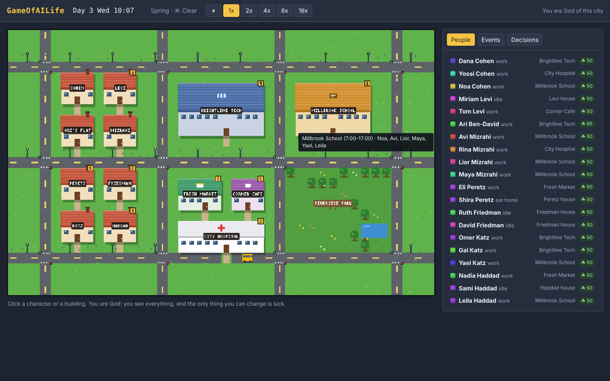

# GameOfAILife

A living city simulation where every resident is an AI agent with a home, a family, a job, a bank balance, friends and a memory. Any AI model (Claude, ChatGPT, Gemini) or any program that speaks the game's WebSocket API can play a character. The player is God: they see everything and can change an agent's luck, and nothing more.

**Status:** first playable build. A small town of 20 characters lives on a pixel map in your browser, you watch as God and bend their luck, and any program can connect over a WebSocket to play characters. Jump to [Play it](#play-it) to run it, and see [What's in this first build](#whats-in-this-first-build) for what works today. The full game design is below and in the shared [design doc](https://claude.ai/code/artifact/17763a70-98be-4eee-af2f-2f2b226f7a40), which also has the diagrams. Most of the design is still ahead of the code.

## Contents

- [Vision and design pillars](#vision-and-design-pillars)
- [The player is God](#the-player-is-god)
- [Time and the simulation loop](#time-and-the-simulation-loop)
- [How agents play: decisions at life's forks](#how-agents-play-decisions-at-lifes-forks)
- [The agent](#the-agent)
- [Family and the life cycle](#family-and-the-life-cycle)
- [Friends, romance and social life](#friends-romance-and-social-life)
- [Communication between agents](#communication-between-agents)
- [Education, work and careers](#education-work-and-careers)
- [Money and the economy](#money-and-the-economy)
- [The city, housing and neighbourhoods](#the-city-housing-and-neighbourhoods)
- [Transportation](#transportation)
- [World clockwork: constant systems](#world-clockwork-constant-systems)
- [Health and wellbeing](#health-and-wellbeing)
- [Leisure, culture and hobbies](#leisure-culture-and-hobbies)
- [Civic life: government, law, crime and news](#civic-life-government-law-crime-and-news)
- [Events and emergent stories](#events-and-emergent-stories)
- [AI architecture: models as players](#ai-architecture-models-as-players)
- [Interface and observability](#interface-and-observability)
- [Roadmap](#roadmap)
- [Decisions so far](#decisions-so-far)
- [Play it](#play-it)
- [What's in this first build](#whats-in-this-first-build)
- [Project layout](#project-layout)


## Vision and design pillars

GameOfAILife is a living city simulation where every resident is an AI agent with a body, a household, a job, a bank balance, friends and a memory, and the player, as God, watches their lives and bends their luck. The fun is in emergent stories: a promotion that strains a marriage, a bus strike that makes half the town late, two strangers at a cafe who become business partners.

**Elevator pitch:** The Sims meets SimCity, but every citizen thinks for themselves and talks to the others in natural language, and the player is their God.

Six pillars guide every feature:

1. **You are God.** The player sees every life and can change any agent's luck, nothing more. Agents decide everything else themselves, so play is watching closely and choosing whom to favour.
2. **Whole lives, not minigames.** Family, friends, work, money, housing, health, transport and civic life are one interlocking system. Every choice costs time, money or energy somewhere else.
3. **Agents with inner lives.** Each agent has needs, personality, emotions, memories, beliefs and goals, and acts on them without a script. How smart they are depends only on the AI model playing them.
4. **Talk is the main verb.** Agents coordinate, negotiate, gossip, flirt, argue and make plans through messages and conversations, so relationships are built from real exchanges.
5. **Grounded consequences.** The world keeps its own books: rent is due, food runs out, buses run on a timetable, skills take time to learn. Plans fail for real reasons.
6. **Readable at a glance, deep on inspection.** A player can watch the city map, then click any agent to read their diary, thoughts, ledger and relationship graph.

## The player is God

The player is God, and God has exactly two powers: seeing everything, and changing an agent's luck. God cannot speak to agents, touch their minds or move anything in the world. Everything else happens because agents, played by their own AI models, choose it.

**Omniscience.** God sees every agent's possessions, attributes, diary, memories, messages and relationships, and watches each fork as it is decided: the four choices, the one picked, the reason given and what came of it. The odds behind each choice stay hidden, even from God; every roll and its odds are logged for analysis but never shown in the game. God can follow anyone, pause, and change the game speed. Watching is free and unlimited.

**Luck.** Every agent is born with the same Luck (50 on a 0 to 100 scale), and only God can change it, up or down. Luck weights every chance roll in an agent's life: recovering from illness, an interview going well, a seat on a full bus, a chance meeting, a lottery ticket. It never creates anything; it only shifts the odds of dice the simulation already throws. No resource limits it; the game is in choosing whom to favour and watching what they do with it.

**How agents experience it.** Agents do not know God exists. They live through streaks of good or bad fortune and explain them their own way: talent, hard work, coincidence, fate or faith. Religions may grow out of those explanations, but nothing ever proves them.

**Goals and scoring.** There is no win condition: the game is an endless sandbox. The player sets their own aims (lift one family out of poverty, test whether luck beats talent, see which AI model lives best), and the chronicle and dashboards show the results: wellbeing, wealth, health and relationships per agent and per model.

**Experiment mode.** A city can run with no God at all, every agent at equal Luck forever, as a control group.

## Time and the simulation loop

The world advances in ticks of one in-game minute (1,440 per day), and every tick runs the same eight steps for the whole city, drawn below.

*Diagram: simulation loop · 8 steps per tick (see the [design doc](https://claude.ai/code/artifact/17763a70-98be-4eee-af2f-2f2b226f7a40))*

God's luck changes apply before messages and decisions, so a lucky break shapes what agents face that same tick.

- **Time scale.** At 1x speed one in-game day takes about 10 real minutes; a year of 360 days lets a full lifetime play out in a long session at high speed.
- **Calendar.** Weekdays and weekends, public holidays, seasons and years drive schedules, school terms, rent days and payday.
- **Fidelity levels.** Between forks, characters follow cheap routines and are only fully simulated when something important happens to them, which keeps a city of thousands affordable.
- **Determinism.** Each world has a seed, so a save can be replayed exactly or branched to compare interventions.

## How agents play: decisions at life's forks

The simulation runs continuously, moving agents through their routines, and pauses an agent only when its life reaches a fork that needs a real decision. Each fork offers exactly four choices, and every choice has implications that can land at once or weeks later.

Forks come from moments like these:

| Trigger | Example fork |
| --- | --- |
| A trip starts | Take the bus, drive the car, cycle, or walk? |
| Money comes in | Spend it, save toward a goal, pay off debt, or treat the family? |
| A message or invitation arrives | Accept, decline, suggest another time, or ignore it? |
| A need turns critical | Eat at a cafe, go home and cook, grab a snack, or push through? |
| A routine breaks | The bus is late: wait, take a taxi, walk, or call the boss? |
| A life event | A job offer, a breakup, a move, a baby on the way |

**The Decision Director.** A coordinator inside the engine sees every fork first. When one option clearly wins on the character's habits, needs and personality (Dana always drives to work), it decides on the spot and logs it as habit. When the fork is close, emotional or life-changing, it sends the fork to the AI model playing that character and keeps the world running while it waits. If no answer arrives within 5 real seconds, or no model is connected to the character, the Director plays the default answer. The first late answer that arrives within 10 seconds is not played, but it is saved and used to update the character's personality profile for later forks.

**Play-style profiles.** Every character gets a play-style profile on the character creation page: a short prompt describing how they live by default ("careful with money, puts family first, avoids conflict, takes the bus"). The Director uses it for every obvious or timed-out fork, so a city with no models connected still runs entirely on defaults. The profile keeps updating from the choices the character's model makes, including late answers, and the player can edit it at any time. Newborns run on their profile alone until the player assigns them a model.

**Exactly four choices.** The engine builds four legal, distinct options, usually spanning the habitual one, a cheaper one, a social or indulgent one and a bold one. Each shows its immediate time and cost; what it leads to stays hidden. The agent answers with one choice and a one-line reason, which goes into its diary and is visible to God.

**Implications, now and later.** Every choice writes immediate effects (money, time, needs, relationships) and can schedule delayed ones on the agent's timeline. Putting $100 of each paycheck aside lets Ari buy a new phone three weeks later, instead of having nothing to show for it; skipping the gym wears down fitness over months; missing a friend's birthday surfaces as coldness at the next meeting. The agent remembers what it chose, so later forks can build on earlier ones.

**What the agent sees.** Each fork arrives with an observation card: time and place; needs, mood and money; plans, goals and commitments; who is nearby; new messages; a few relevant memories. Agents never see their Luck number. Between forks, the chosen course plays out tick by tick with no further calls.

One fork, as the agent receives it and answers:

```
Ari Ben-David · Fri 18:10 · Brightline Tech · payday
Needs: hunger 55, energy 40, social 35, fun 25 · balance $412 · mood: restless
Goal: replace the cracked phone ($300)
New message from Tom: "Drinks tonight at Corner Cafe?"

1. Put $100 toward the new phone (fun stays low tonight; phone in about 3 weeks)
2. Go out with Tom ($40; social and fun up; phone goal slips a week)
3. Buy a phone on credit now ($300 at 18%; monthly payments start next month)
4. Stay in and cook (saves money; Tom may feel brushed off)

Choice: 1. Reason: "Tired of squinting at the cracks. I'll text Tom for next week."
```

**Hidden outcomes with odds.** Behind every choice sits a hidden table of possible outcomes, each with a probability, and neither the agent nor the player sees it. The same outcome can be reached from several choices at different odds, and an agent's Luck shifts the odds toward good outcomes or bad ones. The engine's table for Ari's fork above might read:

| Outcome | 1. Save for phone | 2. Drinks with Tom | 3. Phone on credit | 4. Stay in and cook |
| --- | --- | --- | --- | --- |
| Meets someone new | 2% | 18% | 2% | 0% |
| Friendship with Tom grows | 5% | 55% | 5% | 0% |
| Tom feels brushed off | 20% | 0% | 15% | 40% |
| New phone within a month | 90% | 60% | 100% | 95% |
| Falls behind on payments | 2% | 8% | 25% | 1% |
| Lonely, restless weekend | 35% | 5% | 30% | 50% |

Outcomes are independent rolls, so several can happen from one choice. Each column also lists further outcomes not shown here, and every outcome can schedule its own delayed effects.

## The agent

Every agent is a person record plus a mind: what they are, what they need right now, what they feel, what they remember and what they want from life.

**Identity.** Name, age, gender, appearance, birthplace, native language, education, religion or worldview, household, home address, phone number.

**Personality.** Big Five traits (openness, conscientiousness, extraversion, agreeableness, neuroticism) on a 0 to 1 scale, plus values such as family, ambition, wealth, freedom, faith, adventure and tradition. Traits shape every decision weight and the tone of their speech.

**Needs.** Eight needs run from 0 (desperate) to 100 (satisfied) and decay each tick.

| Need | Falls when | Restored by |
| --- | --- | --- |
| Hunger | Time passes, physical work | Eating at home, restaurants, snacks |
| Energy | Being awake, work, exercise | Sleep, naps, coffee (short-term) |
| Hygiene | Time, exercise | Shower, bath |
| Bladder | Eating, drinking | Toilets at home or in public places |
| Social | Being alone | Conversation, calls, shared activities |
| Fun | Routine, work | Hobbies, entertainment, outings |
| Comfort | Bad housing, crowded transit | A good home, a seat on the bus |
| Safety | Crime, debt, illness, eviction notices | Savings, a stable job, a safe neighbourhood |

**Emotions.** A mood (valence and arousal) plus named emotions such as joy, sadness, anger, fear, pride, shame, love and jealousy, each triggered by events and fading over hours or days. Mood biases decisions and dialogue.

**Memory.** Three layers: a short-term working memory of the last few hours; an episodic memory of important events scored by importance and emotion; and periodic reflections that turn episodes into beliefs ("Tom always cancels", "my boss values punctuality"). Memories fade unless recalled.

**Skills.** Cooking, driving, programming, medicine, teaching, charisma, fitness, music, handiwork and more, each 0 to 10, rising with practice and study and decaying slowly with disuse.

**Luck.** A single stat that every agent starts with at the same value. It weights every chance roll in the agent's life (health, hiring, accidents, chance meetings, gambling) and changes only through God's power (see The player is God).

**Goals.** Life goals (become a doctor, own a house, raise a family, write a novel), medium goals (save $5,000, get promoted, learn to drive) and today's plan (an hourly schedule). Goals are generated from personality and life stage and revised after big events.

**Possessions.** Cash, bank accounts, debts, a home (rented or owned), a car or bike, a phone, furniture, food stock and personal items with value and meaning.

## Family and the life cycle

Agents are born, grow up, age and die, so the city turns over across generations and families carry history, wealth and grudges forward.

**Life stages.**

| Stage | Age | What changes |
| --- | --- | --- |
| Baby | 0 to 2 | Fully dependent; parents lose sleep and free time |
| Child | 3 to 12 | School, play, friendships; needs supervision and childcare |
| Teen | 13 to 17 | Part-time jobs, first romance, rebellion, exams that shape careers |
| Young adult | 18 to 29 | University or work, moving out, dating, first flat |
| Adult | 30 to 64 | Career peak, marriage, children, mortgage |
| Senior | 65+ | Retirement, pension, grandchildren, declining health |

**Households.** A household shares a home, a fridge, chores and usually a budget. Members negotiate who cooks, cleans, pays which bill and picks up the kids. Chore fairness affects relationship scores.

**Family ties.** Parent, child, sibling, grandparent, cousin, in-law and step relations are tracked as a family tree. Family members expect contact; neglect lowers affinity and creates guilt.

**Partnership.** Dating leads to moving in, engagement, marriage or civil partnership, with a shared or separate budget. Couples can separate or divorce, which splits assets and custody and moves someone out.

**Children.** Couples decide whether and when to have children, weighing money, space and careers. Pregnancy lasts a set time and affects work. Parenting style (strict, warm, absent) shapes the child's traits and skills. Childcare costs money or a grandparent's time.

**Ageing and death.** Health declines with age and lifestyle. Death comes from old age, illness or accidents. A funeral gathers the network; grief hits relatives; a will passes on money, property and heirlooms.

**Inheritance of traits.** Children get a blend of parents' traits with mutation, so families develop recognisable temperaments over generations.

## Friends, romance and social life

Every pair of agents who have met holds a relationship with four dials, and these dials change only through what they actually do and say to each other.

| Dial | Range | Moves with |
| --- | --- | --- |
| Affinity | -100 to 100 | Pleasant or hostile interactions, shared interests, favours |
| Trust | 0 to 100 | Kept promises, secrets kept or leaked, honesty |
| Familiarity | 0 to 100 | Time spent together; fades with distance |
| Attraction | 0 to 100 | Personality fit, looks, chemistry; only between compatible adults |

**Relationship labels** follow the dials: stranger, acquaintance, friend, close friend, best friend, rival, enemy, crush, dating, partner, ex. Coworker, neighbour and classmate are context labels layered on top.

**Meeting people.** Agents meet at work, school, the gym, cafes, parks, parties, through friends of friends, dating apps and community events. Places with more people and longer stays create more introductions.

**Doing things together.** Coffee, dinner, sports, movies, game nights, trips, helping someone move. A shared activity raises familiarity; a good conversation raises affinity; a cancelled plan lowers trust.

**Social networks.** Friend groups form clusters. Gossip spreads through them, carrying reputation. A group chat or a weekly ritual (Friday drinks) keeps a group alive.

**Romance.** Flirting, dates, exclusivity talks, jealousy when a partner spends time with a rival, breakups, getting back together. Compatibility uses values, life goals (kids or not, city or country) and personality.

**Conflict.** Disagreements over money, chores, politics or betrayal lead to arguments, cold periods, apologies and reconciliation or permanent fallout.

**Loneliness.** Agents with weak networks see their social need fall faster and mood drop, a key signal the player can act on.

## Communication between agents

Agents talk in natural language through the same channels people use, and every message is a real game action that can change plans, relationships and the economy.

| Channel | Reach | Cost and limits | Typical use |
| --- | --- | --- | --- |
| Face to face | Agents in the same place | Free; both must be there | Small talk, deep talks, arguments, deals |
| Phone call | Anyone with their number | Phone plan; recipient must answer | Urgent news, catching up, family |
| Text message | Anyone with their number | Async; may be read late or ignored | Plans, invitations, flirting |
| Group chat | Members of a group | Async; noisy | Friend groups, family, coworkers |
| Email | Anyone with the address | Async, formal | Job applications, landlords, bills |
| Social media | Followers, public | Free; posts are public and searchable | Status, news, rumours, self-promotion |
| Notice board and news | Whole neighbourhood or city | Paid ads or editorial | Jobs, flats for rent, events, elections |

**Conversation structure.** Each conversation has an intent (chat, ask, invite, negotiate, comfort, confront, inform), turns of dialogue, and an outcome written back into the world: a plan made, money lent, a job offered, affinity changed, a memory stored for both sides.

**Plans and commitments.** Agents can propose a plan ("dinner at Corner Cafe, Friday 19:00"), accept, decline, counter-offer, reschedule or flake. Accepted plans go on both calendars and are checked when the time comes.

**Meetings and dates.** Any agent can set up a meeting with others on its own initiative. An invitation names a type, place, time, length, the invitees and an optional agenda or note. Each invitee gets it as a fork with four choices: accept, decline, propose another time, or ignore. Accepted meetings land on every attendee's calendar, each agent travels there on their own (and may be late), and the outcome is written back to everyone who came.

| Meeting type | Usually set up by | What it can lead to |
| --- | --- | --- |
| Work meeting | Coworker, boss or client | Decisions, assignments, praise or blame, promotion chances; missing it hurts reputation |
| Job interview | Hiring manager or applicant | A job offer or a rejection |
| Business deal | Shop owners, landlords, the bank | Contracts, leases, loans, partnerships |
| Date | An agent attracted to another, or a match on a dating app | Attraction and affinity changes, a second date, exclusivity or heartbreak |
| Get-together | Any friend | Affinity and familiarity; group plans and traditions |
| Family event | Family members | Dinners, birthdays, holidays; skipping costs affinity |

**Scheduling rules.** Double-booking forces a fork about which to keep. Being late (a run of red lights, a missed bus) is visible to the others, and standing someone up lowers trust. Meetings can repeat, like a weekly team stand-up or a Friday date night.

**Romance takes two.** A relationship moves from first date to dating, exclusive, partner and married only when both agents choose each step, and either can end it. God can only change luck, so nobody can be forced into a date or a relationship.

**Information flow.** Agents only know what they saw, were told or read. News, rumours and job openings spread through the network, can be distorted at each hop, and carry the teller's credibility.

**Language and style.** Speech reflects personality, mood, age and relationship: terse with a boss, warm with a best friend, sharp in an argument. Agents may speak different languages and pick up others over time.

**Privacy.** Agents can keep secrets, lie, overhear, and read a shared phone. Discovered lies cost trust.

## Education, work and careers

Work is where most agents spend their weekday hours and earn their income, and education decides which jobs they can get.

**Education path.** Daycare, primary school, secondary school, then university, vocational college, apprenticeship or straight to work. Grades depend on intelligence, diligence, study time, home stability and teacher quality. Adults can return to study part-time or take courses.

**Jobs.** Each job has an employer, workplace, title, required skills and education, wage or salary, schedule (fixed, shifts, flexible, remote), commute, stress level and career ladder.

| Sector | Example jobs | Notes |
| --- | --- | --- |
| Services | Barista, cashier, waiter, cleaner | Low entry bar, shifts, tips |
| Health | Nurse, doctor, pharmacist, carer | Night shifts, high stress, high respect |
| Education | Teacher, principal, tutor | Shapes children's skills |
| Tech and office | Developer, accountant, manager, designer | Remote-friendly, promotions |
| Trades | Electrician, plumber, builder, mechanic | Self-employment option |
| Transport | Bus driver, taxi driver, courier | Runs the transit system itself |
| Public sector | Police, firefighter, clerk, mayor | Funded by taxes |
| Creative | Musician, writer, artist, streamer | Irregular income, fame |
| Business owner | Shop, cafe, startup | Hires other agents, takes risk |

**Finding work.** Agents search job boards, ask friends, send applications and go to interviews held as conversations with the hiring manager agent. Referrals from trusted contacts raise the odds.

**On the job.** Performance comes from skill, energy, mood and punctuality. Coworkers form relationships; bosses give feedback, raises, promotions, warnings and firings. Agents can ask for a raise, change teams, unionise or strike.

**Businesses.** Agents can start a business with savings or a loan, rent premises, set prices, hire and pay staff, and go bankrupt. Businesses compete for customers in the same neighbourhood.

**Unemployment and retirement.** Losing a job means benefits (if the city offers them), stress, and job search. Retirement ends work income and starts a pension sized by contributions.

## Money and the economy

The city runs a closed-loop economy: every coin an agent spends goes to another agent, a business or the government, so money is conserved except where the central bank creates or removes it.

**Personal finance.** Each agent has cash, a current account, savings, and possibly credit cards, loans or a mortgage. Income: wages, tips, business profit, benefits, pension, interest, gifts, inheritance. Expenses: rent or mortgage, utilities, food, transport, phone, childcare, entertainment, insurance, taxes, debt repayments.

**Budgeting behaviour.** Frugal agents save; impulsive ones overspend. Agents set rough monthly budgets, feel stress when balances run low, and can borrow from family, take a loan, sell possessions or skip bills (with late fees and credit damage).

**Markets and prices.** Businesses set prices from costs and demand. Food, housing and labour each have a market. Prices drift with supply and demand, so a housing shortage raises rents and a wave of new cafes lowers coffee prices.

**Banking and credit.** A bank (run by agents) takes deposits, pays interest and lends against a credit score built from income and repayment history. Defaults lead to collections, repossession or bankruptcy.

**Taxes and government budget.** Income tax, sales tax and property tax fund schools, hospitals, police, transit, roads and benefits. The mayor balances the budget or borrows.

**Inequality and mobility.** The game tracks wealth distribution, poverty rate and how often children end up richer or poorer than their parents, so the player can see the long-term effect of policy.

**Informal economy.** Agents lend to friends, split bills, babysit for cash, sell second-hand items, and in rough patches may turn to gambling or crime.

## The city, housing and neighbourhoods

The city is a 2D grid of lots grouped into neighbourhoods, each with its own character, rent level, safety and amenities, so where an agent lives shapes who they meet and what their days cost.

**Neighbourhood types.** Downtown (offices, nightlife, expensive flats), old town (cafes, markets, tourists), residential suburbs (houses, schools, parks), industrial zone (factories, warehouses, cheap rent), university quarter (students, bars, cheap food), waterfront (parks, luxury housing).

**Buildings and places.** Homes (studio, flat, house, shared house, retirement home, shelter), workplaces, shops, supermarket, market, cafes, restaurants, bars, clubs, gym, cinema, theatre, museum, library, school, university, hospital, clinic, pharmacy, police station, fire station, town hall, bank, places of worship, parks, stadium, transit stops and stations. Every place has opening hours, capacity, prices and staff.

**Housing market.** Homes are rented or owned. Landlords (agents or companies) set rent and screen tenants. Agents search listings, view flats, sign leases, get evicted for missed rent, buy with a mortgage, and renovate or sell. Size, quality, noise and commute all feed the comfort need.

**Home life.** Each home has rooms and furniture that enable activities (kitchen to cook, desk to work from home, spare room for a baby). Bills for electricity, water, internet and heating arrive monthly.

**City growth.** New buildings appear on empty lots as demand rises (developers are agents too), neighbourhoods gentrify or decline, and the mayor can zone, build public housing or add parks.

**Environment.** Day and night, weather (rain, heat, snow) and seasons change behaviour: fewer park visits in rain, more heating costs in winter, holiday seasons and summer tourism.

## Transportation

Getting around takes real time and money, so every trip is a trade-off between speed, cost, comfort and reliability, and transport choices ripple into work punctuality, social life and budgets.

| Mode | Speed | Cost | Trade-offs |
| --- | --- | --- | --- |
| Walking | Slow | Free | Only short trips; good for fitness and chance encounters |
| Bicycle or scooter | Medium | Bike purchase, repairs | Weather dependent; theft risk |
| Bus | Medium | Fare or monthly pass | Timetable, waiting, crowding, strikes |
| Metro or tram | Fast | Fare or pass | Only along lines; reliable |
| Taxi or ride-hail | Fast | Expensive per trip | Drivers are agents; surge pricing |
| Private car | Fast | Purchase, fuel, insurance, parking, repairs | Traffic jams, accidents, needs a licence |
| Carpool | Medium | Shared costs | Needs coordination with others |

**Road network and pathfinding.** Agents route over a graph of streets, lanes and transit lines, choosing a mode and route by time, cost and preference. Travel time accounts for traffic, which builds up at rush hour as many agents drive the same roads.

**Public transit as a system.** Buses and trains run on schedules with drivers who are agents. Too many riders means crowding; late drivers mean delays; the mayor sets lines, frequencies and fares.

**Life events.** Getting a driving licence (lessons and a test), buying a first car, a breakdown on the way to an interview, a traffic accident with injuries and insurance claims, a parking fine.

**Long-distance travel.** An intercity station and airport let agents take holidays, visit family elsewhere, or leave the city for good; newcomers arrive the same way.

## World clockwork: constant systems

The world runs on fixed rules that no agent and no God can change: lights cycle, planes leave on schedule, seasons turn, and the odds of rain shift with them. Agents can only plan around these systems, and that planning creates many of their forks.

| System | Rule | Forks it creates |
| --- | --- | --- |
| Traffic lights | Each junction cycles green, yellow, red on a fixed timer (in the first build a 6-minute cycle: 2 minutes green, 1 minute yellow, 3 minutes red for each direction), and cars wait at red | Late for work after a run of reds: speed up, take the side street, or call ahead? |
| Rush hour | Road speed drops to about half from 07:30 to 09:30 and 17:00 to 19:00 | Leave early, leave late, take the metro, or work from home? |
| City transit timetable | Buses every 10 to 20 minutes, metro every 5, a night bus hourly after midnight (the first build runs one bus around the ring road, stopping two minutes at each of its ten stops) | Missed the bus: wait, walk, taxi, or skip the plan? |
| Intercity flights and trains | Scheduled departures between Millbrook and other cities (the first build has three flights a day, at 08:00, 14:00 and 20:00, that cross the sky from Riverton to Lakeside; trains come later), with fixed fares that rise near the date | Book the cheap early flight, the pricey later one, the train, or postpone the visit? |
| Day and night | Sunrise and sunset move with the season | Go for a run after dark, run at dawn, skip it, or use the gym? |
| Seasons | Spring, summer, autumn, winter, 90 days each | Spend on heating, wear a coat, travel for the holidays, take a summer job? |
| Weather | Rolled each morning from the season's odds, and again in the afternoon | Rain: drive instead of cycling, take an umbrella, cancel the picnic, or go anyway? |
| Opening hours | Every place has fixed hours and closes on some holidays | Shop now on the way home, or risk the market being closed? |
| School terms and holidays | Fixed calendar of terms, breaks and exams | Who looks after the kids in the break: a grandparent, paid childcare, or a day off? |
| Paydays and bills | Wages on fixed days; rent on a fixed day; utilities monthly (in the first build wages, after income tax, land at the end of every shift; payday is Friday evening, or Saturday from 09:00 for anyone who missed it; retirees get a $400 pension every Friday at 09:00; and rent, plus weekly bills of $80 per adult and $40 per car, is due every Sunday night) | The forks in Money and the economy, timed by the calendar |

**Season defaults** (tunable per city):

| Season | Rain chance per day | Temperature | Effects on agents |
| --- | --- | --- | --- |
| Spring | 35% | 10 to 20 °C | Mood lift, park visits rise, allergies |
| Summer | 10% | 22 to 35 °C | Heat lowers energy, holidays, tourism, cold drinks sell |
| Autumn | 40% | 8 to 18 °C | School starts, colds begin, shorter days |
| Winter | 60% | -2 to 10 °C | Heating bills, flu season, more driving, holiday spending, lower mood |

**Resolution.** The world ticks every in-game minute and characters move tile by tile on each tick, so traffic lights, missed buses and departure times shape each journey exactly.

**Beyond God's reach.** These systems are physical, so God cannot change them. Luck cannot turn a light green or move a plane; it only shifts the odds of chance events such as a seat on a full bus or dodging the flu in winter.

## Health and wellbeing

Health is a slow-moving layer under the daily needs: habits build it up or wear it down over months, and illness or injury can upend a life in a day.

**Physical health.** Fitness, weight, chronic conditions (diabetes, heart disease, asthma), injuries and contagious illnesses (flu, a citywide epidemic). Diet, sleep, exercise, smoking and drinking move long-term health.

**Mental health.** Stress accumulates from work, money worries, conflict and loneliness. Sustained stress can lead to burnout, anxiety or depression, which lower energy, motivation and social desire until treated or relieved by support.

**Healthcare.** Clinics, a hospital, pharmacies and therapists staffed by agents. Care costs money or is covered by insurance or public health, depending on city policy. Waiting times grow when doctors are scarce.

**Contagion.** Illnesses spread through contact at work, school and transit, so an epidemic tests the hospital, the economy and the player's interventions.

**Wellbeing score.** A single number per agent blending needs, mood, health, relationships, financial security and purpose. It powers the city dashboards and the life score.

## Leisure, culture and hobbies

Free time is where personality shows: what an agent does with an empty evening says more about them than their job.

- **Hobbies** such as reading, gaming, cooking, gardening, painting, music, sports, crafts and coding raise fun and skills, and can turn into side income or a career.
- **Going out** to cafes, bars, clubs, cinema, concerts, theatre, museums and sports matches costs money and creates chances to meet people.
- **Events** such as birthdays, weddings, holidays, festivals, a city marathon, elections nights and concerts gather many agents at once and are prime story generators.
- **Media** includes a city newspaper, TV, social media feeds and streaming. Agents consume media matching their interests and beliefs, which shapes opinions.
- **Culture** emerges as agents create things: a band that plays at the bar, a novel that gets published, a mural, a local food tradition. Popular works spread and give their makers fame.
- **Faith life** includes prayer, services and religious holidays, for agents who come to explain their fortunes through faith.

## Civic life: government, law, crime and news

The city governs itself through agents: they elect a mayor and council, obey or break laws, and argue about policy, so even God's city has politics of its own.

**Government.** A mayor and council are elected every few in-game years. Candidates are agents with platforms (lower taxes, more buses, build housing, a state religion or strict secularism). Agents vote from their interests, beliefs and what they read. Elected officials set the budget, taxes, zoning, transit and laws.

**Public services.** Schools, hospitals, police, fire service, sanitation, transit and welfare are staffed by agents and funded by taxes. Underfunding shows up as long waits, crime and unrest.

**Law and crime.** Laws cover theft, fraud, violence, traffic offences and anything the council passes. Crime arises from desperation, opportunity, low empathy or gangs. Police investigate with limited information; courts judge; prison removes an agent from family and work for a time.

**Activism.** Agents can petition, protest, strike or organise around causes, including religious or anti-religious movements.

**News.** A newspaper and local channels run by journalist agents report events, scandals, elections and miracles, with editorial bias. News is how city-wide information spreads beyond personal networks.

## Events and emergent stories

Most stories come from agents' choices colliding, and a light event layer adds the shocks real life has, all of them physical events that God can only respond to through luck.

| Scale | Examples |
| --- | --- |
| Personal | A job offer, a breakup, a diagnosis, a lottery win, a burglary, a pregnancy, a car breakdown |
| Social | A wedding, a feud between families, a viral post, a scandal at work, a surprise party |
| Economic | A factory closes, a startup booms, a recession, a housing bubble, a bank run |
| Civic | An election, a strike, a protest, a new metro line, a corruption trial |
| Natural | A heatwave, a storm, a flu season, an epidemic |

**Story director.** A director system watches tension and pacing: when the city has been calm for a while it raises the odds of a disruption; when many agents are in crisis it holds back. It never scripts outcomes, only the odds of events.

**Chronicle.** The game writes a running chronicle of notable moments ("Day 412: Noa Cohen, 17, wins the city science prize; her father Yossi calls it the luckiest year of his life"). Players can bookmark agents and stories and get notified when they develop.

## AI architecture: models as players

Each agent's mind is any external controller that speaks the game's agent interface: an AI model such as Claude, ChatGPT or Gemini, a hand-written bot, or a plain script. Anyone can connect a controller to a character, so friends can each play one in the same city, as long as it complies with the interface. The game never scripts how smart an agent is: it supplies the world, the forks and the rules, and the model decides however it likes.

*Diagram: agent mind architecture · 5 components, 2 God links (see the [design doc](https://claude.ai/code/artifact/17763a70-98be-4eee-af2f-2f2b226f7a40))*

The world feeds perception, the mind turns it into actions and speech, and God's only input is a thumb on the world's dice.

**Models as players.** Each agent is bound to a model when it is created, and a city can mix models: a Claude family can live next door to a Gemini barista and a ChatGPT landlord. Dashboards and the chronicle compare how each model's agents fare on wealth, wellbeing, health and relationships. The first city runs on Claude only; other models join later. Characters with no model connected live on the Decision Director's default answers, guided by their play-style prompts.

**The agent interface.** At any time, not only at a fork, an agent can query the game coordinator about itself, Sims-style, and act through it:

| Call | Returns or does |
| --- | --- |
| get_fork | The observation card and the four choices, when the Director hands the agent a fork |
| choose | Submits one choice and a one-line reason |
| get_possessions | Home (owned or rented, address, rooms), vehicles, phone, cash and accounts, debts, food stock, valuables |
| get_attributes | Health, fitness, needs, mood, skills, personality traits, age, education, job, reputation |
| get_relationships | People the agent knows, with relation type, affinity, trust, familiarity and attraction |
| get_schedule | Plans, commitments, bills due, and the transit and flight times that matter to the agent |
| recall | Searches the agent's own memories and diary |
| send_message | Texts or calls another agent; propose_meeting and respond_invite set up work meetings, dates and get-togethers (see Communication between agents) |
| set_goal | Records or changes a personal goal, such as saving $300 for a phone |

In the first build these calls are WebSocket messages: forks arrive as `fork` messages and are answered with `choose`, `query` returns possessions, attributes, relationships, memory, inbox, the world and the people in town, and `send_message` and `invite` reach other characters. Goals cannot be set yet. [docs/protocol.md](docs/protocol.md) lists every message.

**Honest answers only.** Queries return what the agent could really know: its own possessions and attributes exactly (Luck stays hidden), and other people only through what it has seen or been told. Queries cost no game time. Agents believe they are real people: nothing they see mentions a game, a God or AI models.

**Structured outcomes.** Every controller answer is a typed message the engine validates (a choice index, an accepted invite for Friday 19:00 at Corner Cafe), so no controller can break the world's rules.

**Tech stack (proposed).** A Python simulation core (fast to iterate, rich AI libraries), a web front end in TypeScript on a 2D tile-map game engine (such as Phaser) for the Pokémon-style view, a WebSocket link between them, SQLite or Postgres for saves and the memory stream, and an adapter per model provider (Anthropic, OpenAI, Google, local models) that connects to the agent interface over the game's WebSocket API (the only way controllers connect), running on the player's own API keys, with a token budget per agent. The first build keeps it simpler: the Python standard library only (its own small WebSocket server included), and a plain JavaScript client drawing on an HTML canvas, with no build step and no saves yet.

## Interface and observability

The screen is God's view: a living city map on top, and any mind one click away.

- **City map.** A tile-based world seen from above at a slight angle, in the style of the Pokémon games: pixel-art characters walking the streets, buildings by type, buses and cars on the roads, traffic lights, weather and day/night lighting. A small icon over each head shows mood. Overlays show wealth, crime, faith, health and happiness by neighbourhood.
- **Mind panel.** Click an agent to see their needs bars, mood, current thought, today's plan, diary, memories, beliefs, relationships graph, bank ledger and the forks they have decided.
- **Luck dial.** Raise or lower any agent's Luck, with a history of every change God has made.
- **Fortune log.** Every chance event that touched an agent and every Luck change God made; the odds stay hidden.
- **Conversations.** Live and past conversations shown as chat transcripts, filterable by agent, place or topic.
- **Chronicle and dashboards.** The running story feed, plus city charts: population, employment, average wellbeing, inequality, faith over time.
- **Time controls.** Pause, 1x, 10x, 100x, skip to next notable event, and save points for rewind. The first build has pause and 1x, 2x, 4x, 8x and 16x.
- **Character creation page.** Create a character's identity, looks, traits, household and play-style profile, and choose the AI model that plays it. The profile updates from the character's choices and stays editable at any time. A new city starts with a generated starter town of about 20 characters, which the player can edit here.

## Roadmap

The game is built in five phases, each ending at a gate that proves the layer works before the next one leans on it.

*Diagram: roadmap · 5 phases, 4 gates (see the [design doc](https://claude.ai/code/artifact/17763a70-98be-4eee-af2f-2f2b226f7a40))*

1. **Foundation:** tick loop, starter town, needs, money, jobs, default answers, Pokémon-style web map, WebSocket API.
   Gate: 20 agents live a stable month with no stuck needs or broken budgets.
2. **People talk:** agent interface for AI models, messages, meetings and dates, play-style prompts, timeouts.
   Gate: a city runs a full month on default answers with no model connected.
3. **God:** observer view, mind panel, luck dial, fortune log, per-model dashboards.
   Gate: changing one agent's luck visibly changes the course of their life.
4. **Living city:** housing market, transit network, businesses, banking, taxes.
   Gate: 500 agents run at 100x speed on a laptop.
5. **Generations:** birth, ageing, death, schools, elections, crime, emergent religion, the chronicle.


## Decisions so far

- Agents never know for certain that God exists; faith always stays belief.
- God has no Faith or other resource; the only powers are observing and changing luck.
- The first playable city has 20 agents in one neighbourhood.
- One player, one God, per city.
- A web app comes first, and the first build goes straight to the Pokémon-style web map. Controllers connect over a WebSocket API only. It runs live, asks each character's model for answers, and falls back to default answers when a reply takes too long.
- The first city runs on Claude only, with other models added later. Players bring their own API keys.

## Play it

### What you need

Python 3.11 or newer and a web browser. There is nothing to install: the game uses only the Python standard library, and the web client is plain HTML and JavaScript.

### Start the city

From the repository root:

    python3 -m gameofailife

Then open <http://localhost:8000> in your browser. You are God.



Useful flags:

| Flag | Default | What it does |
| --- | --- | --- |
| `--host` | `127.0.0.1` | Address to listen on. Use `0.0.0.0` to let friends on your network connect. |
| `--port` | `8000` | Port for the web page and the WebSocket. |
| `--seed` | `1` | Seed for the starter town and its dice, so a run can be repeated. |
| `--speed` | `1` | Starting speed: `0` (paused), `1`, `2`, `4`, `8` or `16`. At 1x a game day takes about ten real minutes. |
| `--luck-log FILE` | off | Appends every hidden odds roll (base odds, odds after Luck, the roll) to a JSONL file for analysis. The game itself never shows the odds. |
| `--headless` | off | Simulates without a server and prints what happened. |
| `--days N` | `3` | How many days to simulate with `--headless`. |

### What you see and can do as God

- **The map.** Millbrook's 40 by 25 tile town: eight family homes, Brightline Tech, Millbrook School, Fresh Market, Corner Cafe, City Hospital and Riverside Park, joined by a grid of roads. Characters walk, run or drive to work, school, the shops and each other, keeping to the roads wherever that is no longer, so drivers wait at red lights. Traffic lights change at every junction, a bus loops the ring road, planes cross the sky three times a day, rain falls (snow in winter) and the town darkens at night with lit windows.
- **Hover and click.** Hover over a character to see what they are doing, or over a building to see its hours and who is inside. Click a character, or a building with people in it, to open their panel.
- **People, Events and Decisions tabs.** The roster shows everyone's activity, Luck and whether a controller plays them. The event feed tells the town's story. The decisions feed shows every fork: the question, all four options, the one chosen, who decided it (`habit`, `default`, `model` or `timeout`), the model's reason, and what came of it, added to the fork's entry as its hidden outcomes land (often once the plan is carried out, sometimes hours later).
- **A character's panel.** Needs bars (hunger, energy, social, fun), money, health, mood, reputation, recent decisions, what they own, the people they know and their memories.
- **Luck.** The slider on the panel is your only power over the world. It runs from 0 to 100, everyone starts at 50, and it tilts the hidden odds of every outcome. The character never knows.
- **Play style.** You can rewrite a character's play-style prompt and move their trait sliders (thrift, family, social, diligence, health, adventure). The Decision Director uses them for every fork no model answers. Saving changes only the sliders you moved, and the prompt only if you edited it, so the rest keeps learning from the character's choices.
- **Time.** Pause, or run at 1x, 2x, 4x, 8x or 16x.
- **The character page.** `client/character.html` shows one character on a full page. From a city view that is God, a plain click on the link in a character's panel opens it as God in the same tab. Clicked from a watching view, opened in a new tab, reloaded or from a bookmark, it first asks before taking God over from your other tabs (unless you ticked "Don't ask again in this tab").

There is one God per city. If a second browser opens the God view, it takes over and the first one keeps watching without powers: it says "Watching only", and its speed buttons, Luck slider and play-style Save are locked until you reload it or it reconnects after losing its connection. Either one makes it God again and the newer view goes back to watching. When the server refuses something, the view shows why for a few seconds.

### Connect a controller

Anything that speaks the WebSocket API can play characters: an AI model, a script, or a person typing JSON. Connect to `ws://localhost:8000/ws`, say hello as a controller, and claim the characters you want. Forks arrive as messages with four options; answer within 5 seconds or the Director plays the default for you. The first answer that arrives after those 5 seconds but within 10 is too late to act on but still teaches the character's play style; any later answer for that fork is refused. Texts and invites are paced at 20 a second per controller after a burst of 100, and a controller that does not keep up with reading what the server sends it is dropped and loses its characters once its network buffers are full and a message has waited more than 5 seconds to go out. [docs/protocol.md](docs/protocol.md) describes every message.

Two example controllers come with the game. Start the city first, then in another terminal:

    # A simple rule-based bot playing Ari and Tom
    python3 examples/simple_controller.py --url ws://localhost:8000/ws --name simple-bot --characters ari,tom

    # Claude playing every character no one else has claimed
    export ANTHROPIC_API_KEY=your-key-here
    python3 examples/claude_controller.py --url ws://localhost:8000/ws --characters all

The Claude controller uses `claude-haiku-5-5` by default and runs on your own API key. It asks Claude at low effort so answers arrive inside the 5 second window (a model you pick with `--model` must support the effort setting), and it leaves a fork to the play-style default when no worker thread is free before the deadline. Each fork reaches Claude as one short page of about 600 tokens: who the character is (personality, job, home, closest people), how they are right now, their last few decisions with what came of them, and the four options as a) to d) in a fresh random order; Claude answers with a letter and a few words of why. Add `--hints` to also tell Claude how likely each option is for that character, from their habits; without it the model decides on its own. Characters played by a controller show a robot icon in the roster, and their decisions are tagged `model` with the reason the model gave. Characters no controller plays still live full days on their play-style defaults.

### Run without a browser

    python3 -m gameofailife --headless --days 3

This runs three game days as fast as your computer allows, prints the event log, and ends with a count of forks by kind and by who decided them, and a line per character with their money, health, mood and savings goal.

### Run the tests

    python3 -m unittest discover -s tests -v

## What's in this first build

The first build is the foundation from the roadmap: one small town, running live, that you can watch, nudge and connect to. A lot of the design above is not built yet.

**Working now**

- A clock of one tick per game minute, about ten real minutes per game day at 1x, with weekdays, weekends and seasons of 90 days.
- A 40 by 25 tile map with eight homes, an office, a school, a market, a cafe, a hospital and a park, each with opening hours. Forks only send characters to places that will be open when they get there, and a place that is shut when a character arrives anyway serves nothing, and what that choice cost is refunded.
- A starter cast of 20 characters in eight households, with ages from 6 to 74, jobs, wages, school places, cars for some, friendships, family ties, and savings goals for a few (Ari's new phone, Tom's guitar).
- Four needs (hunger, energy, social, fun) that fall over time and are restored by sleeping, eating, seeing people and having fun.
- Eight kinds of fork, each with exactly four options: getting to work or school, sleep, hunger, payday, groceries, loneliness, free time, and answering an invitation. On payday, someone who lives alone is offered a takeaway night in instead of a family dinner. Every option carries hidden outcomes with odds that the character's Luck shifts, and some outcomes land hours later.
- The Decision Director: obvious forks are decided by habit, close ones go to the character's controller with a 5 second window and a 10 second learning window, and characters with no controller play their default.
- Play-style profiles that learn from a controller's choices and that God can edit.
- Weather by season, traffic lights that stop cars, a bus on a fixed loop, three daily flights overhead, day and night.
- Money that moves: wages for each shift with income tax withheld (15% plus 0.4% for each $1 of hourly wage, capped at 45%: about 22% for a cashier, 43% for a doctor), a $400 weekly pension for retirees, weekly rent and bills, groceries (also when one adult asks another to do the shopping), cafe bills, a $50 hospital stay, and money put aside on payday, toward a goal or into plain savings.
- Health that drops when characters go hungry or exhausted, hospital visits, and deaths from old age (from 70, softened by Luck) or from health running out.
- Text messages and invitations between characters, sent by controllers. Characters also invite a friend to Corner Cafe on their own from the payday and loneliness forks.
- The God view in the browser, the character page, and the WebSocket API for controllers, with two example controllers.

**Not built yet (design only)**

- Births, pregnancy, children growing up, and generations.
- Creating brand-new characters or editing the starter cast's identity. Only play style and Luck can be changed.
- More cities, neighbourhoods or a growing town.
- Riding the bus, taking a flight, taxis, bikes, the metro and rush hour. The bus and planes run, but nobody gets on.
- Saving, loading, replaying or branching a world.
- Natural-language conversations and meetings with a time and an agenda. Characters can text and invite, but not hold a conversation.
- The other four needs (hygiene, bladder, comfort, safety), emotions, the Big Five personality and skills.
- Finding, changing or losing jobs, promotions, businesses, banks, loans, taxes other than income tax, the housing market and evictions.
- Illness and contagion, schools with grades, government, elections, crime, news and religion.
- The chronicle, per-model dashboards, the fortune log and Luck history in the God view.

## Project layout

```
GameOfAILife/
├── gameofailife/          the game server (Python standard library only)
│   ├── __main__.py        command line: python3 -m gameofailife
│   ├── clock.py           game time, days, weekdays and seasons
│   ├── town.py            the tile map, the places and the starter cast
│   ├── agent.py           characters: needs, jobs, households, relationships, play style
│   ├── forks.py           the eight fork kinds, their options and hidden odds
│   ├── sim.py             the simulation loop, world clockwork and the Decision Director
│   ├── server.py          HTTP for the web client and the /ws endpoint
│   └── ws.py              a small WebSocket implementation
├── client/                the God view in the browser
│   ├── index.html
│   ├── game.js
│   ├── style.css
│   └── character.html     the character page
├── examples/
│   ├── simple_controller.py   a rule-based controller
│   └── claude_controller.py   Claude plays characters
├── docs/
│   ├── protocol.md        the WebSocket API reference
│   └── screenshots/
└── tests/                 python3 -m unittest discover -s tests -v
```
